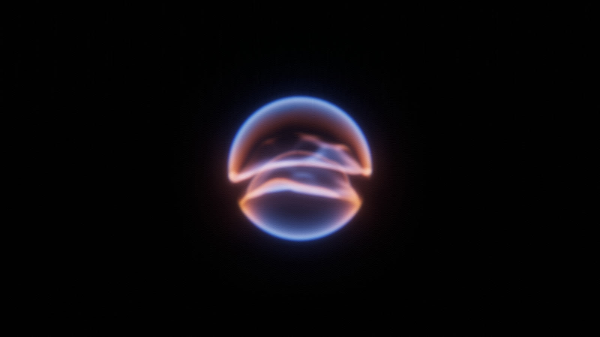

# Light Orb Shader

Two translucent hemispheres of light, split by a moving, saddle-shaped gap, rendered in real time in the browser with [Three.js](https://threejs.org). A companion to [Light Ribbon Shader](https://github.com/marcinkwiatkowski605/light-ribbon-shader).

**Live demo:** https://marcinkwiatkowski605.github.io/light-orb-shader/

The orb is a sphere of light cut in half. The two halves are cool blue glass with rounded edges, held apart by a gap that bends into a saddle and rolls around the orb. The flat faces where the sphere was cut ripple with a moving displacement map, and warm amber light gathers only along the edges where the halves meet. The animation loops seamlessly every 5 seconds.

Every value can be changed live from the control panel.

## Run it locally

It is a single HTML file with no build step. Open `index.html` in a modern browser with WebGL 2. If the browser blocks it when opened from disk, start a local server in this folder (`npx serve .` or `python3 -m http.server`) and open the address it prints.

Three.js and lil-gui load from the jsDelivr CDN, so the first load needs an internet connection.

## Controls

The panel in the top-right corner has these groups:

| Group | What it changes |
| --- | --- |
| **Shape** | Sphere radius, view tilt, the cut between the halves (tilt, saddle height, offset), gap, edge rounding and softness, the cut, saddle, wobble and spin cycles per loop and their phases, loop length, orb size |
| **Shells** | Fresnel power, shell and interior brightness, limb fade, cool and warm colours, colour softness, phase and cycles per loop, warm edge width and variation, cut face brightness, displacement amount, scale, drift and cycles per loop |
| **Post-processing** | Bloom strength, radius and threshold, blur, exposure, grain, chromatic aberration, vignette |
| **Voice** | Microphone toggle and a live level meter; the input range (silence / full level in dB), attack and release, and how much the voice opens the gap, adds glow, pulses the size, ripples and churns the cut faces, speeds up the loop and adds bloom |
| **Pause** | Freezes the animation |

All motion is set in whole cycles per loop, so the animation always loops without a seam.

## How it works

1. **The cut.** The surface that splits the sphere is a smooth height field: a slightly tilted plane plus a saddle, `cutTilt·(z·cos ψ − x·sin ψ) + saddleHeight·(2xz·cos φ + (x² − z²)·sin φ)`. With both terms at zero it is a flat plane and the halves are true hemispheres. `φ` advances once per loop, so the saddle wave travels around the orb. The same GLSL is shared by every layer, so they always agree.
2. **Domes.** One sphere mesh is drawn twice with additive blending, once above the cut and once below, each stopping half the gap short of it. A fresnel term lights them, softer on the far wall and faded right at the silhouette.
3. **Cut faces.** Each half is closed by a dense disc built in the vertex shader on the cut. A value-noise displacement map pushes it along its normal, edges included; the dome's edge follows the same noise, so the two stay joined. Near the rim the face bends up into the dome along a quarter-circle fillet, which rounds the edge.
4. **Colour.** The halves are cool throughout. The warm colour appears only in a band along the edges where the halves meet, with a strength that varies around the orb and turns once per loop.
5. **Post-processing chain.** `RenderPass → UnrealBloomPass → separable Gaussian blur (one or two rounds) → OutputPass (ACES tone mapping, sRGB) → final pass (chromatic aberration, vignette, grain)`. The blur radius is a fraction of the screen height, so the orb looks equally soft on a phone and on a 4K screen.

## Voice control

Open the **Voice** group and click **Enable microphone**. The orb then reacts to sound: louder input opens the gap between the halves, brightens and slightly enlarges the orb, makes the cut faces ripple and churn, and speeds up the loop. The level follows the voice with a fast attack and a slower release, so the orb swells with each syllable and settles between words. If it reacts to background noise, raise **Silence below (dB)**; if it barely moves, lower **Full level at (dB)**.

Browsers only grant the microphone on `https://` or `localhost` pages (some also allow `file://`), so use a local server if the prompt does not appear. The audio never leaves the browser. With the system's Reduce motion setting on, the orb turns at a quarter speed and the voice changes only its brightness and gap.

Add `?capture=1440x1080` (any `WxH`) to the URL to render fixed-size frames with no panel and no animation loop; `window.__orb.setTime(t)` and `window.__orb.renderFrame()` then produce any frame on demand.

## Tech

- [Three.js](https://github.com/mrdoob/three.js) r170 (WebGL 2, `EffectComposer`, `UnrealBloomPass`, `ShaderPass`, `OutputPass`)
- [lil-gui](https://github.com/georgealways/lil-gui) 0.19 for the control panel
- Custom GLSL vertex and fragment shaders

## Credits and licence

Code: © 2026 Marcin Kwiatkowski, released under the [MIT License](LICENSE).

Third-party libraries keep their own licences. See [THIRD_PARTY_NOTICES.md](THIRD_PARTY_NOTICES.md).

This is an independent project, inspired by the soft light effects in modern voice-assistant interfaces. It is not affiliated with, endorsed by or connected to any company or product.
